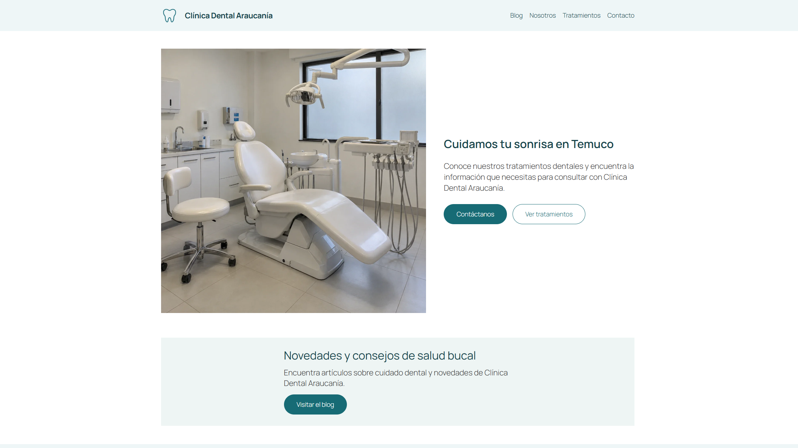
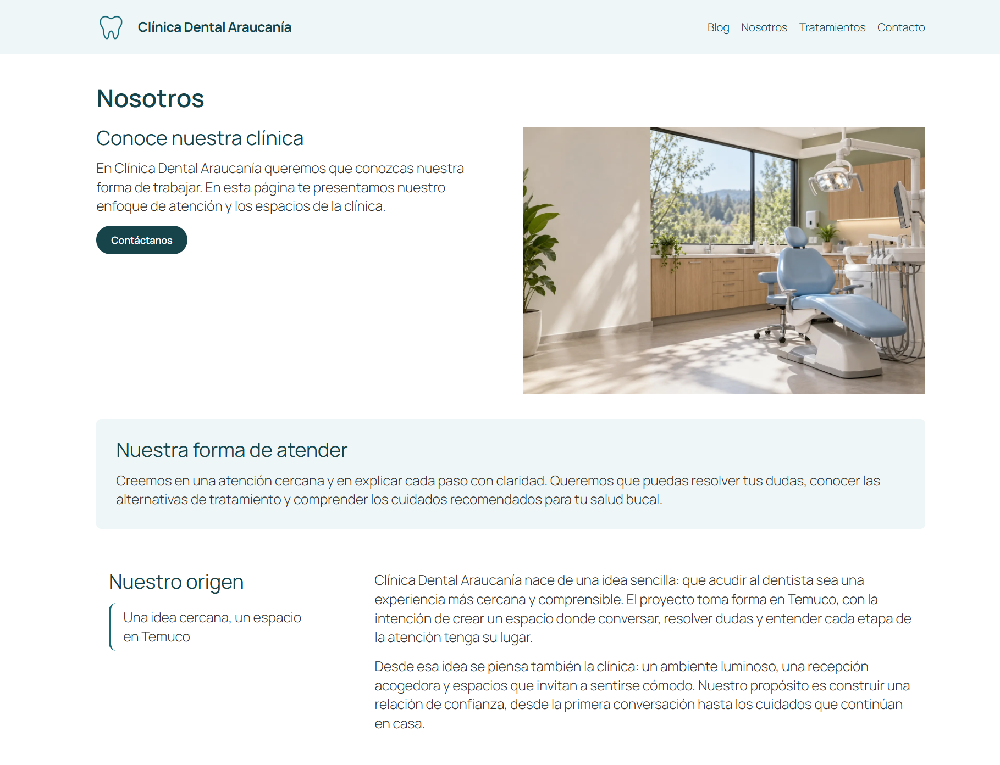

# Clínica Dental Araucanía

Proyecto personal de aprendizaje y portafolio: sitio web para una
clínica dental ficticia ubicada en Temuco, Chile.

Desarrollado desde un entorno local hasta
su publicación en un hosting.

## Sitio publicado

[Visitar Clínica Dental Araucanía](https://clinicadentalaraucania.freedev.app/)

## Objetivo

Construir un sitio administrable con páginas informativas, blog,
campos de contacto editables y un formulario con envío de correo.

## Funcionalidades

- Páginas de Inicio, Nosotros, Tratamientos, Contacto y Blog.
- Publicaciones organizadas por categorías.
- Contenido construido con Gutenberg.
- Página Nosotros diseñada con Elementor.
- Horario y correo visibles administrados mediante ACF.
- Shortcodes personalizados con PHP.
- Estilos y efectos hover personalizados.
- Formulario de contacto con Contact Form 7.
- Envío de correo mediante WP Mail SMTP y Resend.
- Títulos SEO y metadescripciones configurados con Yoast SEO.
- Adaptación del diseño a escritorio, tablet y móvil.

## Tecnologías y herramientas

WordPress, Gutenberg, Elementor, ACF, PHP, HTML, CSS, JavaScript,
Code Snippets, Contact Form 7, WP Mail SMTP, Resend y Yoast SEO.

Tema padre: Twenty Twenty-Five.
Entorno local: Local.
Hosting de demostración: InfinityFree.

## Personalizaciones incluidas

- `tema-hijo/`: archivos del tema hijo.
- `snippets/`: código de los shortcodes de horario y correo.
- `estilos-adicionales.css`: copia del CSS guardado en el editor
  de Apariencia.
- `capturas/`: evidencias visuales del sitio.

Los snippets se utilizan mediante Code Snippets. Los archivos PHP
de esta carpeta son copias para consulta y no se cargan automáticamente.

El CSS adicional también requiere incorporarse en WordPress para
aplicarse; su presencia en este repositorio no lo activa.

## Capturas

### Inicio en escritorio

### Nosotros en escritorio

## Comprobaciones realizadas

- Navegación y botones principales.
- Visualización de páginas y publicaciones.
- Guardado y recuperación de un borrador.
- Envío de prueba desde WP Mail SMTP.
- Recepción de una consulta del formulario en Gmail.
- Visualización de imágenes en un teléfono físico y al girar la pantalla.

## Aprendizajes

## Aprendizajes

- Instalar y configurar WordPress en un entorno local.
- Utilizar el panel de administración y sus principales ajustes.
- Crear, editar y organizar páginas y entradas.
- Diferenciar entre guardar un borrador, publicar y programar contenido.
- Instalar, activar, configurar y actualizar plugins según una necesidad.
- Diferenciar las funciones de WordPress, los temas y los plugins.
- Editar contenido con Gutenberg y diseñar una página con Elementor.
- Adaptar el diseño a escritorio, tablet y móvil.
- Optimizar imágenes y añadir textos alternativos.
- Configurar títulos SEO y metadescripciones con Yoast SEO.
- Separar el contenido administrable de su presentación mediante ACF.
- Crear shortcodes con PHP básico y personalizar estilos en un tema hijo.
- Configurar un formulario y comprobar la recepción de sus correos.
- Migrar archivos y base de datos desde Local al hosting.
- Investigar y documentar incidencias técnicas.

## Limitaciones conocidas

- La clínica es ficticia y el sitio no ofrece atención real.
- El envío con el remitente de pruebas de Resend está limitado
  al destinatario registrado en la cuenta.
- Se observó un fallo de imágenes al cambiar de dispositivo
  en DevTools; no se reprodujo en la prueba del teléfono físico.
- El repositorio no contiene toda la configuración almacenada
  en la base de datos.

## Alcance y datos excluidos

Este repositorio documenta las personalizaciones del proyecto.
No permite reconstruir el sitio completo por sí solo.

No incluye WordPress completo, plugins, base de datos,
`wp-config.php`, contraseñas ni claves API.

## Autor

Ricardo Fuentes — Ingeniero Informático.